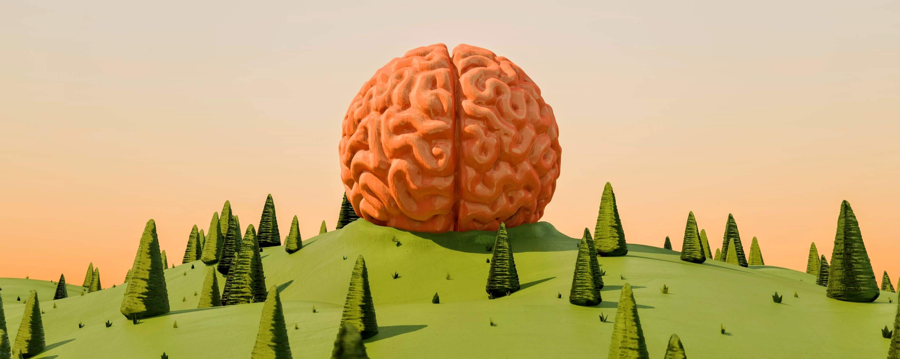
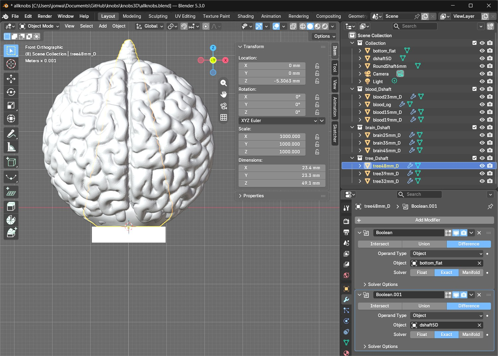
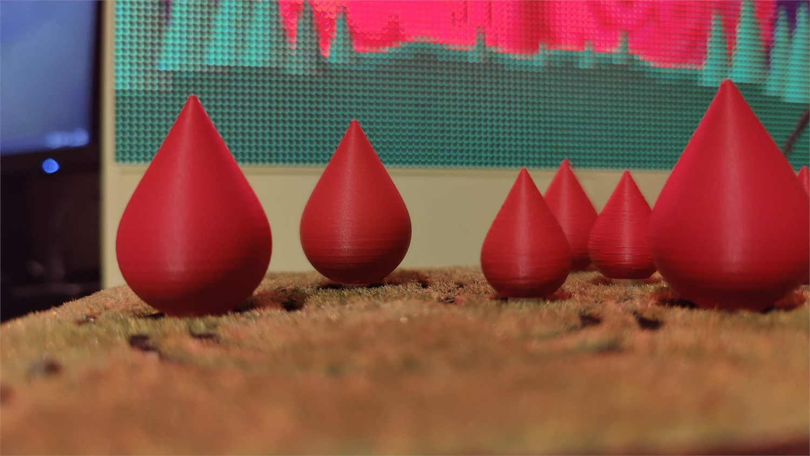
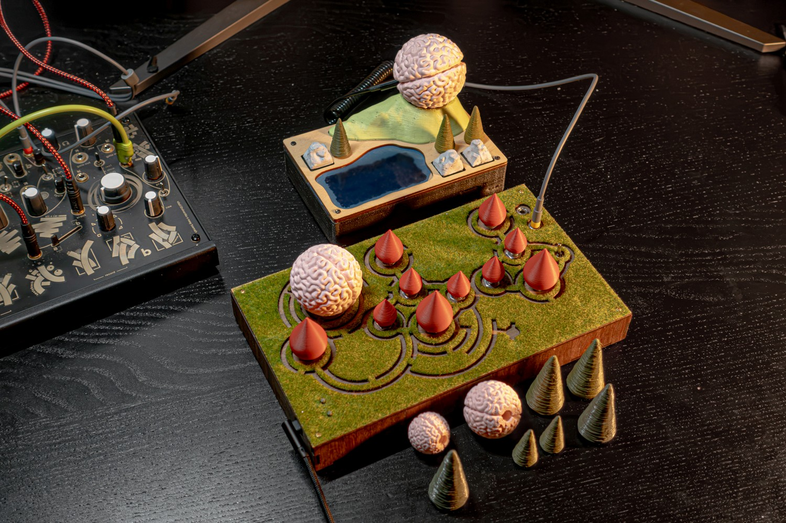
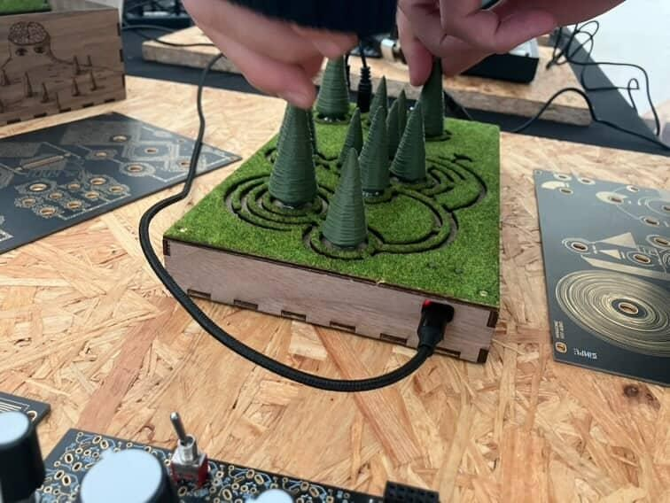
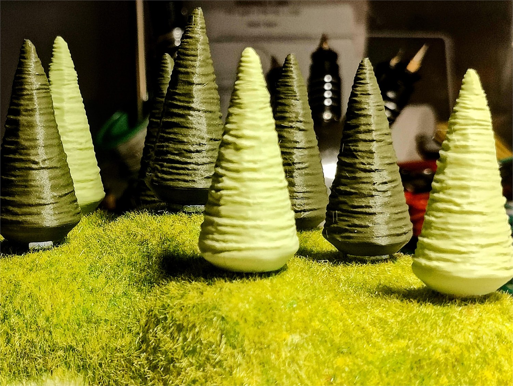

# knobs



A home for my ongoing Landscpr universe with custom knobs for potentiometers and possibly other future assets.

The `allknobs.blend` file is the master file that contains all the models with a D-shaft modifier (round shaft versions will come later). Using the Blender file with modifiers ensures non-destructive original shapes.

## Folder Structure

```text
knobs3D/
├── allknobs.blend
├── allknobs-blender_file.jpg
├── brainscape_eevee_render_wide.jpg
├── blood/
│   ├── blood.3mf
│   ├── blood15mm__dshaft.stl
│   ├── blood19mm__dshaft.stl
│   ├── blood23mm__dshaft.stl
│   └── blood_3Dprint_installed.jpg
├── brain/
│   ├── brain25mm_dshaft.stl
│   ├── brain35mm_dshaft.stl
│   ├── brain45mm_dshaft.stl
│   ├── brain_blood_trees_3Dprint_feedbackGarden_shieldXL.jpg
│   └── brain_dshaft.3mf
└── tree/
    ├── feedbackgardenscprAudrey_trees3Dprint.jpg
    ├── tree32mm_dshaft.stl
    ├── tree39mm_dshaft.stl
    ├── tree48mm_dshaft.stl
    ├── tree_Dshaft_AudreyFeedbackGarden.3mf
    └── trees3Dprint_landscpr.jpg
```

## Previews

### Blender Master File


### Blood


### Brain


### Tree



## License

This work is licensed under the [Creative Commons Attribution-NonCommercial 4.0 International License (CC BY-NC 4.0)](LICENSE).

Feel free to use these, but i'd love to get a picture if you do.

